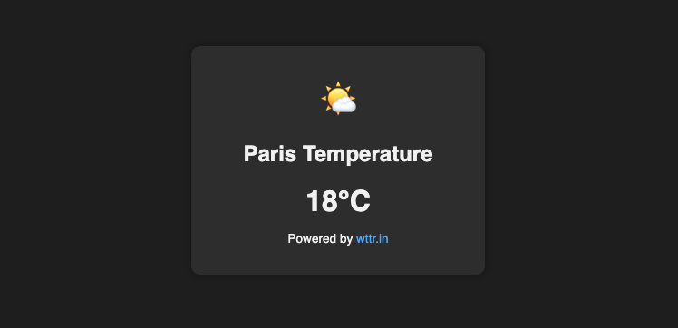

<h1>
  <span class="headline">Selenium: Data-Driven Testing</span>
  <span class="subhead">Integrating API Data in Selenium Tests</span>
</h1>

**Learning objective:** Call a public API to use real-time data as part of your test logic.

## Testing with Real-Time Data

Until now, you’ve used static files (like CSV or JSON) to drive your tests. But real-world data—like weather, news, or prices—changes constantly. Testing with live API data ensures your application works with up-to-date information, just like your users expect.

> 💡 Example: If you’re testing a weather widget, using real API data means your test can verify today’s actual temperature—not yesterday’s.

Connecting Selenium to public APIs helps you check that your UI reflects live external data accurately, bringing your automation closer to how real users experience your site.

## Making a GET request to a public API

Public APIs are designed to be accessible to anyone. You send them a simple HTTP request and receive fresh data back—often in JSON format.

Python’s _requests_ library makes retrieving this data straightforward. Let’s walk through an example using _[wttr.in](https://github.com/chubin/wttr.in)_, a free, simple weather API that gives you weather information for any city.

Suppose you want to get the latest temperature in Paris for your Selenium test.

```python
import requests

response = requests.get("https://wttr.in/Paris?format=j1")
print(response.status_code)  # Prints: 200 if the request succeeded
print(response.text)         # Prints: Raw JSON response as a string
```

> 💡 You can try this with any public API, but always check their documentation to avoid hitting usage limits and to respect how they want their data accessed.

### Extracting just the data you need

Most APIs give you back JSON—structured data that Python can parse. You don’t want the whole data blob; you want the key field for your test.

Here’s how you isolate the temperature for Paris:

```python
import requests

response = requests.get("https://wttr.in/Paris?format=j1")
if response.status_code == 200:
    data = response.json()    # Converts JSON string to Python dictionary
    current = data['current_condition'][0]
    temperature_c = current['temp_C']
    print(f"Current temperature in Paris: {temperature_c}°C")
else:
    print("Failed to get data from API")
```

> APIs often return nested structures. Always inspect the JSON to find where your needed information lives.

<div class="activity guided-walkthrough">
  <h2 class="title">Demo: Making a GET request to a public API</h2>
  <span class="minutes">15 min</span>
</div>

Let’s walk through a practical scenario:

**Scenario:**
Your web app has a widget showing the current temperature for Paris. You want to make sure this value matches what users would see if they checked a reliable source.

**For this exercise, use the 📄 `temperature_widget.html` file created during setup.**



<br>

<blockquote class="attention">
Note:
The temperature displayed in this html widget is hardcoded, since this is not a live website. To see your Selenium test pass or fail based on different temperatures, you'll need to manually update the temperature value in the HTML file before running your test.
</blockquote>

### Step 1: Import your tools

**Create a new test file called `test_temperature_widget.py`, and include these imports:**

```python
import requests
from selenium import webdriver
from selenium.webdriver.common.by import By
```

### Step 2: Make a live API call for temperature

Use the free **[wttr.in](https://github.com/chubin/wttr.in)** weather API to get current temperature data for a city.

Paste this function into your test file:

```python
def get_live_temperature(city):
    url = f"https://wttr.in/{city}?format=j1"
    response = requests.get(url)
    if response.status_code == 200:
        return response.json()['current_condition'][0]['temp_C']
    else:
        raise Exception("API call failed")
```

### Step 3: Write a Selenium test to verify the widget

Now let’s compare the widget’s temperature to the API value:

```python
def test_temperature_widget_shows_live_temp():
    driver = webdriver.Chrome()
    city = "Paris"

    # Get live temperature from the API
    live_temp = get_live_temperature(city)

    # Visit the local test page
    driver.get("file:///Users/username/path/to/example_file.html") # Replace with the full absolute path to your local HTML file

    # Get the temperature displayed on the page
    widget_value = driver.find_element(By.ID, "temp-widget").text  # ex: "18°C"
    widget_temp = widget_value.strip().replace("°C", "")

    # Compare temperatures (allow small differences)
    assert abs(int(widget_temp) - int(live_temp)) <= 1, \
        f"Widget ({widget_temp}) should be within 1°C of API ({live_temp})"

    driver.quit()
```

> 💡 This structure lets you confidently check the accuracy of your web widget against the same data source users might use.

The test passes if the widget is within 1°C of the live API value.

If the test fails, it could indicate:

- A real bug in the widget
- Cached or delayed data in the UI.
- A network issue while calling the API.

## Patterns and Best Practices for API-Driven Tests

| Practice                         | Why It Matters                                                                                       |
| -------------------------------- | ---------------------------------------------------------------------------------------------------- |
| **Handle errors gracefully**     | If the API is down or returns bad data, your test should fail with a clear, useful message.          |
| **Defend against data changes**  | Check that keys and types exist before accessing values—APIs can change unexpectedly.                |
| **Respect rate limits**          | Many APIs limit how often you can call them—use mocks or local copies when testing frequently.       |
| **Limit usage to key scenarios** | Use live APIs for dynamic UI checks, not for tests needing stability (e.g., large-scale form input). |

## Knowledge check: API-driven testing challenges

❓ When using live API data in your Selenium tests, what are two risks you should plan for, and how can you design your tests to handle them gracefully?
