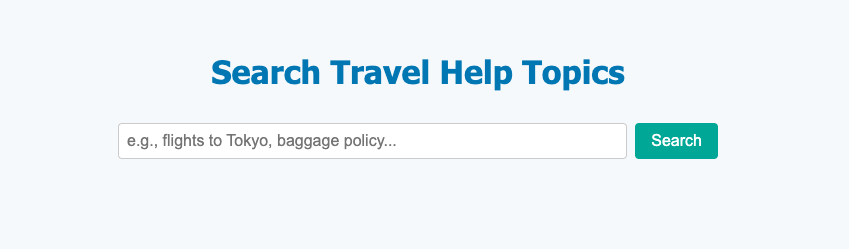

<h1>
  <span class="headline">Selenium: Data-Driven Testing</span>
  <span class="subhead">Introduction to Data-Driven Testing</span>
</h1>

**Learning Objective:** Understand the benefits of data-driven testing for improving test coverage and reuse.

## Why use data-driven testing?

Imagine you are testing a travel booking website. You want to verify that users can log in with different types of usernames and passwords: some short, some long, some with special characters, and so on. If you write a separate test for every scenario by copying and pasting your code, your test suite expands quickly and soon becomes difficult to maintain.

Data-driven testing solves this. It lets you keep your test logic in one place while loading many input values from an external file like a CSV.

> 💡 This keeps your code clean, helps you test more scenarios faster, and makes it easier to update tests later.

## Hard-coded vs. data-driven

Let's compare two approaches for automating a login test.

### Hard-coded test

Each test includes specific input values written directly in the code:

```python
def test_login_with_valid_credentials(driver):
    driver.get("http://localhost:8000/login.html")
    driver.find_element(By.ID, "username").send_keys("adina77")        # sends the username
    driver.find_element(By.ID, "password").send_keys("welcome2023")    # sends the password
    driver.find_element(By.ID, "submit").click()                       # clicks the submit button
    assert driver.find_element(By.ID, "welcome-message").is_displayed()    # checks welcome message
```

Want to test a new user? You have to copy the test and change the values. That’s time-consuming and error-prone.

### Data-driven test

Instead, you can store test data in a separate file, like login.csv:

```csv
username,password
adina77,welcome2023
li.chen,MyPa$$word
oliver.karim,superSecure1
```

Then write a test that loads and uses this data:

```python
import csv
from selenium import webdriver
from selenium.webdriver.common.by import By

# Initialize the browser
driver = webdriver.Chrome()

# Open the CSV file and read the data (skip the header row)
with open("login.csv", newline='') as f:
    reader = csv.reader(f)
    next(reader)  # Skip header row
    for row in reader:
        username, password = row

        # Navigate to the login page
        driver.get("http://example.com/login")

        # Fill in login form
        driver.find_element(By.ID, "username").send_keys(username)
        driver.find_element(By.ID, "password").send_keys(password)
        driver.find_element(By.ID, "submit").click()

        # Placeholder for actual check
        assert "Welcome" in driver.page_source

# Close the browser after all rows are tested
driver.quit()
```

> 🏆 Best practice: Now you can test multiple user accounts with one test function. Add new rows to the CSV and your test runs with them automatically.

## Why this helps

Benefits of separating test data from test logic:

- **Less code duplication** – One test handles many cases
- **Faster updates** – Add or change test cases by editing the data file only
- **Better test coverage** – Try more combinations and edge cases with less effort
- **More maintainable** – Your test logic stays clean and focused on behavior

## Visualizing the Data-Driven Workflow

Here’s how data-driven testing works in practice:

1. **Create your data file**

   - Build a file like `login.csv` that includes the inputs you want to test—such as different usernames and passwords.

2. **Write a flexible test**

   - Use Python to read each row of the file and run the same Selenium steps with those values.

3. **Grow your test coverage easily**
   - Need to test more users or edge cases? Just add new rows to the data file—no need to change your test code.

> 💡 This approach makes it simple to test more, with less work.

<div class="activity guided-walkthrough">
  <h2 class="title">Turn a Basic Selenium Test into a Data-Driven Test</h2>
  <span class="minutes">15 min</span>
</div>

Practice refactoring a hard-coded Selenium test to use a CSV file for input. This helps improve test reuse, reduce duplication, and increase coverage across varied scenarios.

🔍 **Scenario**

You’re testing a simple search form on a travel site. Right now, your test script is hard-coded to enter just one search query. Your goal is to make this test reusable for many different queries using data stored in a `.csv` file.

1. **For this exercise, use the 📄 `search.html` file created during setup.**



<br>

2. **Create a file called 📄 `search_data.csv` and paste in the following:**

```csv
flights to Tokyo
rebooking policy
luggage allowance
cancelations
```

1. **Create a new 📄 `search_test.py` test file**

- Start by writing a hard-coded test that runs one search:

```python
from selenium import webdriver
from selenium.webdriver.common.by import By

driver = webdriver.Chrome()

driver.get("file:///Users/username/path/to/example_file.html") # Replace with the full absolute path to your local HTML file
driver.find_element(By.ID, "search-box").send_keys("flights to Tokyo") # hard coded single search option
driver.find_element(By.ID, "submit").click()
result = driver.find_element(By.ID, "results").text
assert "flights to Tokyo" in result
driver.quit()
```

4. **Now let's refactor it to use our 📄 `search_data.csv` file:**

```python
import csv
from selenium import webdriver
from selenium.webdriver.common.by import By

driver = webdriver.Chrome()

with open("search_data.csv", newline='') as csvfile:
    reader = csv.DictReader(csvfile)

    for row in reader:
        driver.get("file:///Users/username/path/to/example_file.html") # Replace with the full absolute path to your local HTML file
        driver.find_element(By.ID, "search-box").send_keys(row["query"])
        driver.find_element(By.ID, "submit").click()
        result = driver.find_element(By.ID, "results").text
        assert row["query"] in result

driver.quit()
```

> 💡 You’ve now created a data-driven test—you can add more queries to your CSV file, and the test will automatically run them.

## Knowledge check

❓ Consider a scenario where your product’s login page changes—now passwords need at least one symbol. How does using data-driven testing help your team adapt both quickly and reliably?
