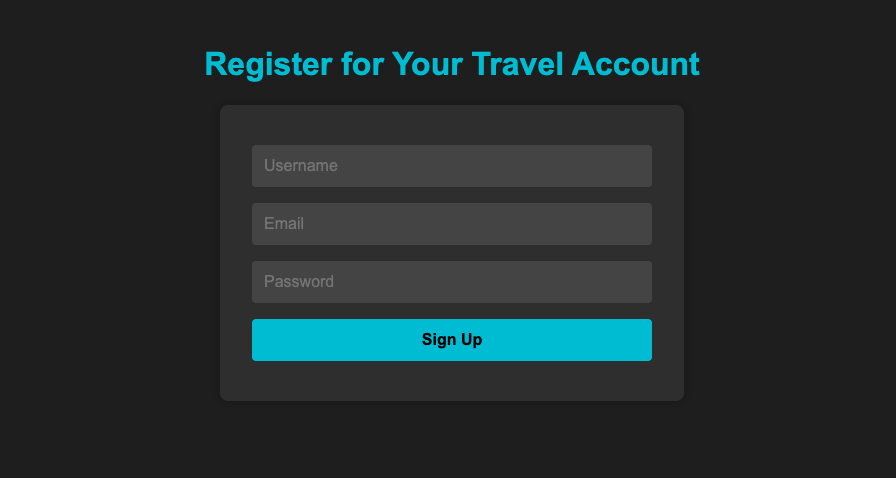

<h1>
  <span class="headline">Selenium: Data-Driven Testing</span>
  <span class="subhead">Parameterizing Selenium Tests</span>
</h1>

**Learning objective:** Use data to parameterize Selenium tests (for example, form submissions, login variations).

In the previous lesson, we began learning data-driven testing by:

- Creating CSV and JSON files with structured test inputs.
- Loading those files into Python.
- Exploring how test data could be read dynamically instead of hard-coding it.

That laid the groundwork for parameterization — the next step is learning how to plug those external data sources into their Selenium test functions so that the same logic runs across multiple scenarios.

## Why Parameterization Matters

When testing something like a registration form on a global travel site, users bring all kinds of data—different usernames, passwords, and edge cases. Writing one test per scenario quickly becomes tedious and error-prone.

**Parameterization** solves this. It lets you write your test logic once and run it many times, each with different input data from a file like a CSV or JSON. You get more coverage with less code—and fewer mistakes.

## How Python and `pytest` Make Test Parameterization Easy

When you're ready to run the same test logic with many different inputs, `pytest` can help—no need to write a separate test function for each case. It includes a tool called `@pytest.mark.parametrize`, which automatically loops through sets of values for you.

Here’s a simple example using three different username/password combinations for a login test:

```python
import pytest
from selenium.webdriver.common.by import By

# This tells pytest to run the test once for each username/password pair
@pytest.mark.parametrize(
    "username,password",
    [
        ("samira.liu", "Hello#2024"),
        ("eli.otieno", "Pa$$w0rd!"),
        ("sofia.ruiz", "ClaveSegura8")
    ]
)
def test_login_variations(driver, username, password):
    driver.get("http://example.com/login.html")
    driver.find_element(By.ID, "username").send_keys(username)
    driver.find_element(By.ID, "password").send_keys(password)
    driver.find_element(By.ID, "submit").click()
    # Add assertions to check login result

```

This one function will automatically **run three times**, once for each set of test data.

## Using External Files to Feed Your Tests

Hard-coding test data is okay for small demos—but in real projects, you’ll want to keep your data separate from your code. That’s where CSV and JSON files come in. You already explored these formats earlier—now let’s use them to power test parameterization with `pytest`.

### Parameterizing a Registration Test from a `CSV` File

Let’s say you want to test a registration form with different user info. Here’s a CSV file that contains that data:

```plaintext
username,email,password
samira.liu,samira@email.com,Hello#2024
eli.otieno,eli@email.net,Pa$$w0rd!
sofia.ruiz,sofia@correo.mx,ClaveSegura8
```

Now we’ll write a Python test that reads this file and uses the data in a loop:

```python
import pytest
import csv
from selenium.webdriver.common.by import By

# Step 1: Read the CSV and convert each row into a tuple
def load_registration_data():
    with open("registration.csv", newline='') as csvfile:
        reader = csv.reader(csvfile)
        next(reader)  # Skip the header row
        return [tuple(row) for row in reader]

# Step 2: Use pytest to loop over the data and pass each row to the test
@pytest.mark.parametrize("username,email,password", load_registration_data())
def test_registration_variations(driver, username, email, password):
    driver.get("http://example.com/register.html")

    # Fill in the registration form
    driver.find_element(By.ID, "username").clear()
    driver.find_element(By.ID, "username").send_keys(username)

    driver.find_element(By.ID, "email").clear()
    driver.find_element(By.ID, "email").send_keys(email)

    driver.find_element(By.ID, "password").clear()
    driver.find_element(By.ID, "password").send_keys(password)

    driver.find_element(By.ID, "submit").click()

    # Add assertions here to verify success or error messages
```

> 🧠 The magic here is that you only update the CSV file to add or remove test cases. Your test logic doesn’t change—this makes maintaining large suites much easier.

### Parameterizing a Registration Test from a `JSON` File

CSV is great for flat, simple data—but when your test data includes **lists, roles, or nested values**, `JSON` is the better fit.

Let’s say your app now shows different dashboards depending on a user’s role (like customer, admin, or support). Your test needs to simulate these variations.

```json
[
  { "username": "samira.liu", "password": "Hello#2024", "roles": ["customer"] },
  {
    "username": "eli.otieno",
    "password": "Pa$$w0rd!",
    "roles": ["admin", "customer"]
  },
  { "username": "sofia.ruiz", "password": "ClaveSegura8", "roles": ["support"] }
]
```

Now let’s write a test that reads this `JSON` file and passes the data into Selenium:

```python
import pytest
import json
from selenium.webdriver.common.by import By

# Step 1: Read and parse the JSON data
def load_user_data():
    with open("users.json") as jsonfile:
        users = json.load(jsonfile)
        return [
            (user["username"], user["password"], user["roles"])
            for user in users
        ]

# Step 2: Parameterize the test to use each user's data
@pytest.mark.parametrize("username,password,roles", load_user_data())
def test_login_with_roles(driver, username, password, roles):
    driver.get("http://example.com/login.html")

    driver.find_element(By.ID, "username").send_keys(username)
    driver.find_element(By.ID, "password").send_keys(password)
    driver.find_element(By.ID, "submit").click()

    # Step 3: Add assertions based on user roles (this will vary by app)
    # Example placeholder:
    print(f"Logged in as {username} with roles: {roles}")
```

> 💡 Use JSON when your data includes lists, nested fields, or anything beyond basic columns. It’s perfect for simulating real-world user profiles and permissions.

## Two ways to loop: Decorators versus manual iteration

You’ve seen how `@pytest.mark.parametrize` helps you run one test with many sets of data. But sometimes, a manual for-loop is simpler—especially in scripts or custom workflows.

**Manual loop using CSV data:**

```python
import csv
from selenium.webdriver.common.by import By

def test_registration_manual_loop(driver):
    with open("registration.csv", newline='') as csvfile:
        reader = csv.DictReader(csvfile)
        for row in reader:
            driver.get("http://example.com/register.html")
            driver.find_element(By.ID, "username").clear()
            driver.find_element(By.ID, "username").send_keys(row["username"])
            driver.find_element(By.ID, "email").clear()
            driver.find_element(By.ID, "email").send_keys(row["email"])
            driver.find_element(By.ID, "password").clear()
            driver.find_element(By.ID, "password").send_keys(row["password"])
            driver.find_element(By.ID, "submit").click()
            # Add assertions or reset steps as needed
```

🔄 Manual loops give you more control, but don’t show each data set as a separate test result in reports like pytest does.

## When should you use each approach?

**`@pytest.mark.parametrize`**:

- You want clear, separate test results for each scenario.
- Suitable for continuous integration and large, growing test suites.
- Makes it easy for teammates to spot which scenarios failed.

**Manual for-loop**:

- Useful for exploratory work or complex scenarios where more setup is needed between runs.
- Lets you control dynamic behaviors or custom logging.
- Often preferred in scripts that automate UI interactions outside of structured test runners.

<div class="activity solo-exercise">
  <h2 class="title">Refactor a registration test with CSV-based parameterization</h2>
  <span class="minutes">10 min</span>
</div>

Put your data-driven testing skills to work! In this solo exercise, you'll refactor a basic Selenium test to use a CSV file for multiple input scenarios.

In this exercise, you’ll:

- Prepare a CSV file with multiple test scenarios for a registration form.
- Refactor an existing test from a single, hard-coded case to a data-driven parameterized test.
- Run your test and observe how it adapts to more scenarios—no code changes required when you expand your data.

1. **For this exercise, use the 📄 `registration.html` file created during setup.**

   

   <br>

2. **Create a new 📄 `registration.csv` file with the following contents:**

   ```plaintext
   username,email,password
   samira.liu,samira@email.com,Hello#2024
   eli.otieno,eli@email.net,Pa$$w0rd!
   sofia.ruiz,sofia@correo.mx,ClaveSegura8
   ```

   - ✅ Optional: Add more rows as global edge cases—for instance, single-character usernames, emails in different scripts, or special symbols in passwords.

3. **Create a new 📄 `registration_test.py` test file and start from a basic, non-parameterized test:**

   ```python
   from selenium import webdriver
   from selenium.webdriver.common.by import By

   driver = webdriver.Chrome()

   def test_register_basic():
       driver.get("file:///Users/username/path/to/registration.html")  # Replace with your actual file path
       driver.find_element(By.ID, "username").send_keys("samira.liu")
       driver.find_element(By.ID, "email").send_keys("samira@email.com")
       driver.find_element(By.ID, "password").send_keys("Hello#2024")
       driver.find_element(By.ID, "submit").click()
       # Add assertions here
       driver.quit()
   ```

4. **Refactor: Implement parameterization and run your test. Try to implement on your own before referencing the solution below.**

   ```python
   import pytest
   import csv
   from selenium import webdriver
   from selenium.webdriver.common.by import By

   def load_registration_data():
       with open("registration.csv", newline='') as csvfile:
           reader = csv.reader(csvfile)
           next(reader)  # Skip the header row
           return [tuple(row) for row in reader]

   @pytest.mark.parametrize("username,email,password", load_registration_data())
   def test_register_data_driven(username, email, password):
       driver = webdriver.Chrome()
       driver.get("file:///Users/username/path/to/registration.html")  # Replace with your actual file path

       driver.find_element(By.ID, "username").clear()
       driver.find_element(By.ID, "username").send_keys(username)

       driver.find_element(By.ID, "email").clear()
       driver.find_element(By.ID, "email").send_keys(email)

       driver.find_element(By.ID, "password").clear()
       driver.find_element(By.ID, "password").send_keys(password)

       driver.find_element(By.ID, "submit").click()

       # Add assertions here (e.g., check for success message)

       driver.quit()
   ```

   > 🏆 As requirements change or more cases are needed, you only need to edit the CSV.

5. **Run your tests**

   - Open your terminal and run:

   ```bash
   pytest registration_test.py
   ```

   - Observe that each data row is tested as a separate scenario.

6. **Enhance your test coverage**

   Try adding test cases with:

   - One-letter usernames
   - Unicode email addresses
   - Passwords with symbols, spaces, or different character sets

   This shows how data-driven testing supports global coverage without increasing your test code size.

## Knowledge check

❓ When would you choose to use `@pytest.mark.parametrize `over a manual for-loop in your Selenium tests? In what kinds of projects or situations would each method shine?
