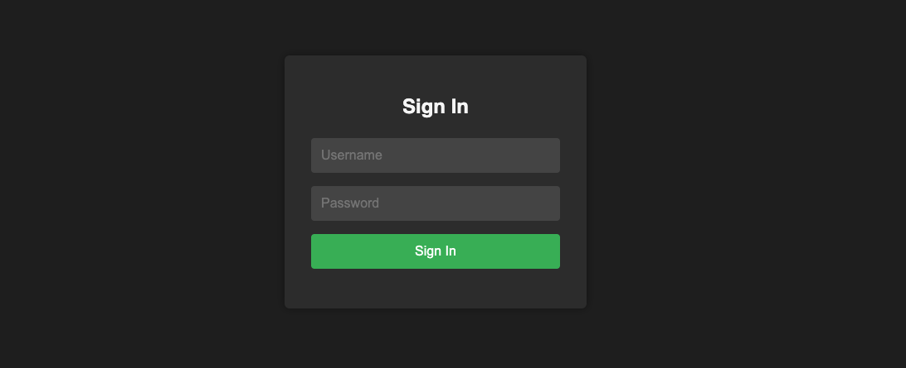

<h1>
  <span class="headline">Selenium: Data-Driven Testing</span>
  <span class="subhead">Working with External Data Sources</span>
</h1>

**Learning objective:** Load and parse data from external sources (CSV and JSON) into Python test scripts.

## From static data to dynamic testing

In the previous section, we explored the difference between hard-coding your test data and designing tests that flexibly use external files to cover a variety of scenarios. Now, let's put that into practice by working directly with some of the most common formats for storing and sharing test data—`CSV` and `JSON`.

Imagine you’re testing a multilingual e-commerce website’s login form. The site is used by customers across several continents, and you want to make sure that your login logic works with usernames and passwords from different countries, languages, and scripts. Instead of copying your test code over and over with new credentials, you can store these values in external files and loop through them automatically in your Selenium tests.

> 💡 This hands-on approach not only gives you broader coverage but also keeps your test suite organized and easy to update as new data comes in.

## How CSV files give life to your tests

_CSV_ (Comma Separated Values) files let you organize data much like a simple spreadsheet. Think of each row as a distinct test case and each column as a category of input or expected result. This is especially useful for features where your data is consistent in shape—like testing different combinations of usernames and passwords.

Consider the following _login.csv_ test data:

```plaintext
username,password
samira.liu,Hello#2024
eli.otieno,Pa$$w0rd!
sofia.ruiz,ClaveSegura8
```

Each row represents a different user attempting to log in.

## Reading CSV data in Python

Python’s built-in _csv_ module is designed to help you work with these files. By using _csv.DictReader_, you get an intuitive mapping where each column header becomes a dictionary key. This makes your code clearer and more robust.

```python
import csv

with open('testdata/login.csv', newline='') as csvfile:
    reader = csv.DictReader(csvfile)
    for row in reader:
        print(row['username'], row['password'])
```

After running this code, you’ll see:

```plaintext
samira.liu Hello#2024
eli.otieno Pa$$w0rd!
sofia.ruiz ClaveSegura8
```

> 😎 Notice how you do not need to remember if a password is the first or second column—_csv.DictReader_ uses the column headers, making your code easier to read and maintain.

## Automating form tests with CSV

Let's see another example. Suppose you want each row in your CSV to guide a real login attempt in your browser test.

```python
import csv
from selenium import webdriver
from selenium.webdriver.common.by import By

driver = webdriver.Chrome()

with open('testdata/login.csv', newline='') as csvfile:
    reader = csv.DictReader(csvfile)

    for row in reader:
        driver.get('http://example.com/login.html')
        driver.find_element(By.ID, 'username').send_keys(row['username'])
        driver.find_element(By.ID, 'password').send_keys(row['password'])
        driver.find_element(By.ID, 'submit').click()
        # Add assertions to verify login success

driver.quit()
```

Each loop increases your coverage—without code duplication!

> 🏆 Best practice: To test new edge cases, add a row to your CSV file. No change to your test code is needed.

## When to choose JSON for your test data

_JSON_ (JavaScript Object Notation) files shine when your data is less structured or needs to capture relationships—for example, when user profiles include additional settings, preferences, or access roles.

Suppose you’re testing a permissions dashboard where each user may have different roles:

```json
[
  { "username": "samira.liu", "password": "Hello#2024", "roles": ["customer"] },
  {
    "username": "eli.otieno",
    "password": "Pa$$w0rd!",
    "roles": ["admin", "customer"]
  },
  { "username": "sofia.ruiz", "password": "ClaveSegura8", "roles": ["support"] }
]
```

You can see how each user’s data can contain lists and more detailed fields than a simple row in a spreadsheet.

> 💡 JSON is especially helpful for nested or hierarchical data, such as user accounts with multiple addresses or an order with several line items.

## Reading JSON data in Python

Working with a JSON file is straightforward using Python’s _json_ module. Here’s how you load and inspect the structure of your test data:

```python
import json

with open('testdata/users.json') as jsonfile:
    users = json.load(jsonfile)
    for user in users:
        print(user['username'], user['password'], user['roles'])
```

Your output will look like:

```plaintext
samira.liu Hello#2024 ['customer']
eli.otieno Pa$$w0rd! ['admin', 'customer']
sofia.ruiz ClaveSegura8 ['support']
```

> 📚 _JSON_ stands for _JavaScript Object Notation_, but it is supported across most programming languages and documents data as lists and dictionaries (objects).

## Using JSON in your Selenium tests

With the data loaded, you can loop through each user and adapt the test based on roles, permissions, or required fields.

```python
import json
from selenium import webdriver
from selenium.webdriver.common.by import By

driver = webdriver.Chrome()

with open('testdata/users.json') as jsonfile:
    users = json.load(jsonfile)

    for user in users:
        driver.get('http://example.com/login.html')
        driver.find_element(By.ID, 'username').send_keys(user['username'])
        driver.find_element(By.ID, 'password').send_keys(user['password'])
        driver.find_element(By.ID, 'submit').click()
        # Insert assertions for user['roles'] or permissions

driver.quit()
```

## Structuring data for clarity and scale

As your application features grow, so will your test data. Well-structured data files let you expand or update scenarios without feeling overwhelmed.

- Use **dictionaries** for fixed fields (like username, password)
- Use **lists** to store many test cases or user variations
- Use **nested structures** (in JSON) for grouped data, such as a profile with both address and preferences

<div class="activity solo-exercise">
  <h2 class="title">Complete a moderately sized puzzle</h2>
  <span class="minutes">10 min</span>
</div>

Now it’s your turn to work directly with these formats. You’ll load external data, analyze its structure, and connect the dots to real automation workflows.

**🔍 Scenario**

You’re working on a login testing feature. Instead of writing separate test cases for each user manually, you want to pull test data from files. This makes it easy to expand coverage and run the same test with different credentials.

**For this exercise, use the 📄 `login.html` file created during setup.**



<br>

1. **Create two new data files called:**

**📄 login.csv**

```csv
username,password
samira.liu,Hello#2024
eli.otieno,Pa$$w0rd!
sofia.ruiz,ClaveSegura8
```

**📄 users.json**

```json
[
  { "username": "samira.liu", "password": "Hello#2024", "roles": ["customer"] },
  {
    "username": "eli.otieno",
    "password": "Pa$$w0rd!",
    "roles": ["admin", "customer"]
  },
  { "username": "sofia.ruiz", "password": "ClaveSegura8", "roles": ["support"] }
]
```

2. **Create a test script called 📄 `test_login_csv.py`:**

```python
import csv
from selenium import webdriver
from selenium.webdriver.common.by import By
import time

driver = webdriver.Chrome()

with open("login.csv", newline='') as csvfile:
    reader = csv.DictReader(csvfile)
    for row in reader:
        driver.get("file:///Users/username/path/to/example_file.html") # Replace with the full absolute path to your local HTML file
        driver.find_element(By.ID, "username").send_keys(row["username"])
        driver.find_element(By.ID, "password").send_keys(row["password"])
        driver.find_element(By.ID, "submit").click()
        time.sleep(1)  # Give the DOM a moment to update

        result = driver.find_element(By.ID, "welcome-message").text
        assert row["username"] in result

driver.quit()
```

4. Try it again using `JSON`

**Create a test script called 📄 `test_login_json.py`:**

Use the first test as your guide and write a test that uses the json data.

<div class="activity discussion">
  <h2 class="title">Reflect</h2>
  <span class="minutes">1 min</span>
</div>

Think of a recent or upcoming test you want to automate. Would your data fit best in a CSV or a JSON file? What changes would you need if you later decided to add new fields (such as language preference or two-factor authentication codes) or handle more complex input structures?
